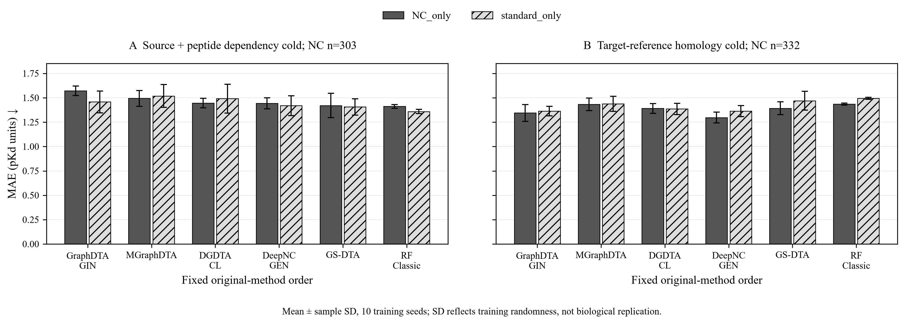

# PPIKB 非标准肽—蛋白亲和力基准

**2,099条非标准肽记录、7,520条标准肽对照，5个前人架构＋随机森林，全部10个训练随机种子。**

本仓库公开2026年10月22日完成的基准代码、数据、测试结果、训练日志、权重、缓存及分析文档。代码和便于浏览的结果位于Git，大型产物位于同一仓库的[Releases](https://github.com/cihebiyql/ppikb-noncanonical-peptide-affinity-benchmark/releases/tag/v1.0.0)。每个文件和分卷均有SHA-256清单。

## 先看结果

- [完整结果与复现说明](docs/基准结果与复现说明.md)
- [全部聚合指标CSV](benchmark/reporting/final-v1/summary.csv)
- [NC主任务指标CSV](benchmark/reporting/final-v1/main-NC.csv)
- [调参与训练元信息](benchmark/reporting/training-metadata-v1/超参数与训练元信息.md)
- [完整epoch预算诊断](benchmark/reporting/training-logs-v1/预算诊断说明.md)
- [逐文件清单](manifest/source-files.jsonl) · [分卷与校验值](manifest/artifact-assets.json) · [数据/产物恢复](docs/ARTIFACTS.md)



严格隔离后的泛化仍弱。来源与肽依赖隔离测试中，12个可训练组合的NC测试MAE均高于标准肽训练中位数常数参考（1.3178）。靶标参考同源隔离测试中，最低展示平均MAE为DeepNC-GEN的NC训练模型：1.2978±0.0554 pKd，R²为0.0638±0.0551。这里的最小均值是描述结果，不是显著性结论。

## 基准范围

| 项目 | 已完成内容 |
| --- | --- |
| 端点 | Kd转pKd；全物种；Ki/IC50保留于原库 |
| NC互斥分层 | 非天然/D型/骨架723；PTM1002；混合268；其他106 |
| 前人架构 | GraphDTA-GIN、MGraphDTA、DGDTA-CL、DeepNC-GEN、GS-DTA |
| 额外基准 | RF-Morgan2-chiral-AAC-DP；3个确定性参考规则 |
| 固定划分 | 来源＋肽依赖隔离；参考靶标同源隔离 |
| 训练对照 | NC_only与standard_only，分别验证集调参 |
| 随机种子 | 每个可训练组合均为0–9；固定数据划分 |
| 计算覆盖 | 400个有效NN候选＋80个RF候选；200＋40个选择模型 |
| 指标 | MAE、RMSE、Pearson、Spearman、R²；11,540组汇总、115,400条逐种子指标 |
| 外部验证 | PTM67主测试＋8条件样本；2条参考靶标冷是67的子集；另补8条非天然肽＋5条标准肽 |
| 独立复核 | NN600与RF120份评分重新计算，指标差异0；240结果记录全部通过验收 |

这是五个发表架构在共同PPIKB数据上的适配重训；训练预算和兼容性修补均已披露。标准训练集更大、靶标/来源分布也不同，对照不能直接作因果解释。外部数据主要验证新来源与声明化学实体，支持范围见完整报告。当前没有构建创新模型。

## 仓库与完整产物

本次原项目文件共28,942个，其中26,937个可公开文件已分配到Git或Release；2,005个第三方原档/运行依赖/可再生字节码等文件逐项登记在[排除清单](manifest/excluded-files.jsonl)。研究自行生成的权重、缓存、预测、指标与日志完整保留。

Git包含26,372个原项目文件；Release包含565个大型产物，分成7卷。所有原项目文件按原字节保存，原始绝对路径作为历史provenance保留；本页及docs提供面向公开仓库的相对链接。

PPIKB原始v5工作簿与许可元数据见[datasets/PPIKB-v5](datasets/PPIKB-v5/)。复现标准与本次5篇登记见[support](support/)，保留了全部中断、审计失败及恢复证据。

## 获取完整内容

```bash
git clone https://github.com/cihebiyql/ppikb-noncanonical-peptide-affinity-benchmark.git
cd ppikb-noncanonical-peptide-affinity-benchmark
python scripts/restore_artifacts.py
python scripts/restore_upstream.py
```

第一步恢复分卷中的研究产物，第二步按URL、commit和SHA获取上游源文件；都不会启动训练。原冻结合同中的路径、版本和运行时限作为历史证据保留。重跑环境与输入适配说明见[方法与数据说明](benchmark/report-preparation/方法与数据说明.md)及各methods目录。

## 来源与许可

PPIKB原始数据：[Figshare v5，10.6084/m9.figshare.31082407.v5](https://doi.org/10.6084/m9.figshare.31082407.v5)，**CC BY 4.0**。本研究进行端点筛选、化学分层、质量标记、严格划分与模型评估，原始21845行工作簿一并保留。外部来源和原始端点详见external-validation的清单。

第三方组件逐项遵守原许可证，见[LICENSES](LICENSES/)和[许可证据](permissions/policy.json)。GraphDTA、DeepNC、GS-DTA的固定版本缺少明确再分发许可，因此其源文件采用原链接＋固定commit＋SHA＋下载恢复；本仓库不为这些代码另授许可。MGraphDTA保留MIT、DGDTA及其修改源保留GPLv3，其他组件和论文原件保持各自许可。供应商保护运行时与安装依赖用来源记录和环境说明替代。
